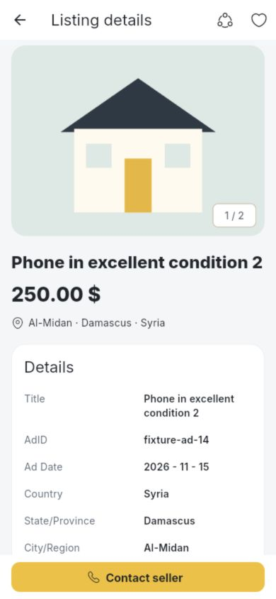
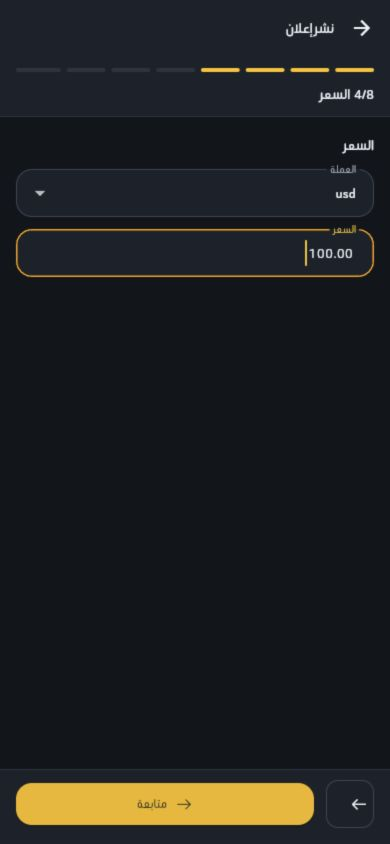

# Pazarna — عرض المشروع

[English](README.md) · [Türkçe](README.tr.md) · [العربية](README.ar.md)

**IDEABAT PROJECT · LIVE · Web / Android / iOS · العربية / English**

موقع متجاوب وتطبيق Flutter لاكتشاف الإعلانات والتواصل مع أصحابها وإرسال إعلان للمراجعة، مع تجربة عربية وإنجليزية.

تستخدم صور الواجهات المحلية بيانات تجريبية. شاشات Flutter مأخوذة من تشغيل التطبيق في المتصفح، ويجب ألا توصف بأنها لقطات أصلية من Android أو iOS. صور الموقع المنشور موسومة بصورة منفصلة.

## التحدي

تحتاج منصة الإعلانات متعددة التصنيفات إلى عرض محتوى متنوع بوضوح، مع اتساق البحث والمبالغ والمواقع الجغرافية ومسار الإرسال بين الويب والهاتف. يعالج التنفيذ المفحوص هذه الحاجة؛ ولم تُقدّم مقابلات مع العملاء أو إحصاءات بحثية أو قياسات مرجعية لنتائج الأعمال.

## الحل

يجمع بازارنا صفحات متجاوبة تُنشأ على الخادم مع تطبيق Flutter وقواعد خلفية مشتركة. وتساعد الحقول المناسبة للتصنيف، وعرض السعر أو الراتب بوضوح، وتخطيط الواجهات حسب اتجاه اللغة، وحفظ المسودة، المستخدم على إعداد إعلانه ومراجعته.

1. تصفح تصنيفًا أو ابحث عن سلعة أو فرصة.
2. ضيّق النتائج وافتح الإعلان لمراجعة الصور والموقع والتفاصيل ذات الصلة.
3. تواصل مباشرة مع صاحب الإعلان؛ ويمكن للمستخدم المسجل في التطبيق حفظ الإعلان أو الإبلاغ عنه.
4. اختر التصنيف في التطبيق وأكمل المعلومات وراجع الإعلان ثم أرسله للمراجعة.

## تطبيق الهاتف: اكتشف واحفظ وأعدّ وراجع

   

الترحيب واختيار اللغة · تصفح الإعلانات · نتائج البحث

   

الإعلانات المحفوظة · عوامل تصفية حسب التصنيف · تفاصيل الإعلان ومعرض الصور

   

إرسال الإعلان: اختيار التصنيف · إرسال الإعلان: المبلغ الأصلي والعملة · إرسال الإعلان: الصور الاختيارية

   

إرسال الإعلان: المراجعة قبل الإرسال · إرسال الإعلان: استلام للمراجعة في اختبار محلي · إعدادات اللغة والمظهر والعملة

## واجهة ويب متجاوبة: تصفح وتحقق

نتائج البحث

تفاصيل الإعلان ومعرض الصور

الانتقال من الموقع إلى تطبيق الهاتف

[استعرض الصور المئة كاملة](GALLERY.ar.md).

## مساهمة Ideabat

عرّف صاحب المشروع العمل بوصفه IDEABAT PROJECT. يشمل النطاق الهندسي الموثق الواجهة المتجاوبة وتجربة Flutter والخادم المشترك المكتوب بلغة PHP. لا تعني هذه النسبة ملكية حصرية لكل مكوّن أو نقل حقوق أي طرف ثالث.

- موقع PHP متجاوب
- تطبيق Flutter لمنصتي Android وiOS
- واجهات PHP مشتركة ونموذج بيانات متوافق مع MySQL
- صفحة عضو مختصرة وانتقال من الويب للتطبيق لإرسال الإعلان

يتشارك موقع PHP وواجهاته البرمجية قواعد العمل ونموذج بيانات متوافقًا مع MySQL، بينما يتواصل Flutter عبر طبقة شبكة مركزية. يساعد توحيد منطق التصفح على اتساق ما يظهر في البطاقات وأعداد النتائج والتفاصيل والمحفوظات. تنفصل هوية الإعلان عن نصه المترجم، وتدعم بنى التصنيفات والمواقع عوامل تصفية مناسبة. يقتصر وصف المعمارية على المكونات المثبتة؛ ولا تُضاف بنية سحابية مفترضة أو عزل متعدد المستأجرين أو نتائج أداء على نطاق واسع.

يحفظ المسار المحمول مسودة تخص صاحب الحساب ويحافظ على المبلغ المدخل وعملته الأصلية. يتحقق الخادم من التصنيف والتسلسل الجغرافي والحقول وقيود الصور قبل استلام الإعلان. تساعد هوية إرسال ثابتة والاستعلام عن الحالة على حسم الردود غير المؤكدة دون إنشاء إعلان آخر عشوائيًا. وصل المسار المحلي دون صور إلى نتيجة مؤكدة بانتظار المراجعة، وبقي الإعلان خارج النتائج العامة. وجود واجهة صور اختيارية لا يثبت عمل أذونات الصور على جهاز فعلي. المراجعة والموافقة مسؤولية تشغيلية منفصلة.

## اللغات والتجربة

تُعرض العربية من اليمين إلى اليسار والإنجليزية من اليسار إلى اليمين. تجمع الهوية بين الأسطح الرمادية الداكنة والإجراءات الصفراء وخطوط عربية ولاتينية مضمنة محليًا. وتبقى خيارات الفاتح والداكن ومظهر الجهاز مستقلة عن لغة الواجهة وعملة العرض. توجد موارد ترجمة تركية، لكن اختيار اللغة الفعلي يقتصر على العربية والإنجليزية. تدعم صور الهاتف واللوحي وسطح المكتب واختبارات محددة للنص المكبّر ملاحظات عن تخطيطات بعينها؛ ولا تثبت امتثالاً شاملاً لمعايير الوصول.

## حقائق المشروع

- جهة الاتصال بالمشروع: RAGIP MULLAMUSA
- الفترة التي حددها صاحب المشروع: سبتمبر 2025–أبريل 2026. توثيق الصيانة في نوفمبر 2026 منفصل عنها.
- PHP · MySQL-compatible SQL · Flutter / Dart · Provider

تشمل القدرات المنفذة تصفحًا مترابطًا بين الويب والهاتف، ومسارات الحساب والإعلانات المحفوظة، وإرسالًا محليًا موثقًا انتهى بحالة انتظار المراجعة. لا تُنسب إلى المشروع زيادة غير مقاسة في الإيرادات أو الاستخدام أو التحويل أو السرعة أو التوافر.

لم تُتحقق تفاعلات الأجهزة الأصلية أو مطابقة المصدر المفحوص لإصدارات المتاجر الحالية. العربية والإنجليزية هما اللغتان الفعالتان في المنتج؛ أما التركية فهي لغة مادة العرض وليست واجهة مفعلة. ولم تتأكد لوحة مستقلة للإشراف على الإعلانات.

## الروابط الرسمية والخطوات التالية

[Pazarna](https://pazarna.com/) · [Google Play](https://play.google.com/store/apps/details?id=pazarna.ideabat.com) · [App Store](https://apps.apple.com/us/app/%D8%A8%D8%A7%D8%B2%D8%A7%D8%B1%D9%86%D8%A7/id6759612932)

تم التحقق من إتاحتها في 16 نوفمبر 2026؛ لم تُحدّث هذه الصفحات بالحزمة المحلية.

**معرض الأعمال:** [English](https://ideabat.com/portfolio/pazarna-classifieds-marketplace/) · [Türkçe](https://ideabat.com/tr/portfolio/pazarna-classifieds-marketplace/) · [العربية](https://ideabat.com/ar/portfolio/pazarna-classifieds-marketplace/)

**دراسة الحالة:** [English](https://ideabat.com/case-study/pazarna-web-mobile-classifieds-marketplace/) · [Türkçe](https://ideabat.com/tr/case-study/pazarna-web-mobile-classifieds-marketplace/) · [العربية](https://ideabat.com/ar/case-study/pazarna-web-mobile-classifieds-marketplace/)

## الملكية والمراجعة التقنية

يحتوي هذا المستودع على توثيق ومواد بصرية معتمدة، وليس إصدارًا للمصدر البرمجي للتطبيق. عرض المشروع عبر Ideabat لا ينقل ملكية أي عميل. للاستفسارات المتعلقة بالتوظيف أو التعاون أو المراجعة التقنية، يمكن التواصل مع راغب ملا موسى عبر Ideabat. يتطلب الوصول إلى مصدر المشروع الخاص إذنًا مسبقًا من صاحبه والالتزام بمتطلبات السرية المعمول بها. تُراجع الطلبات كلٌّ على حدة، ولا يُضمن منح الوصول إلى المصدر. لا يمنح هذا العرض ترخيصًا برمجيًا أو إذنًا بإعادة التوزيع.

راغب ملا موسى هو مؤسس [Ideabat](https://ideabat.com/). للاستفسارات الهندسية أو فرص العمل أو التعاون، يُرجى استخدام [صفحة التواصل](https://ideabat.com/contact-us/) أو البريد [info@ideabat.com](mailto:info@ideabat.com).

