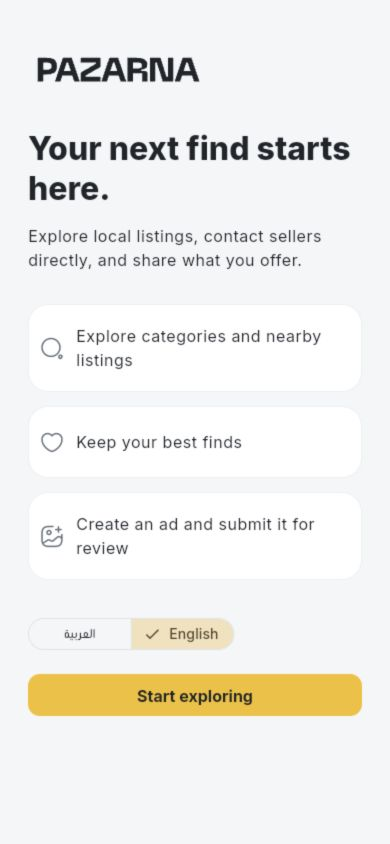
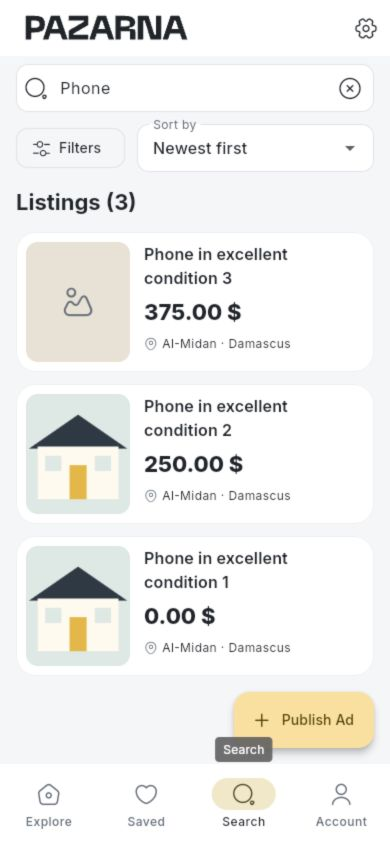
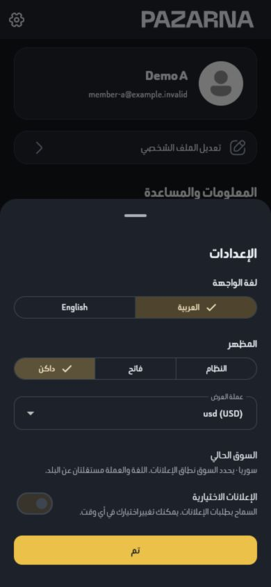
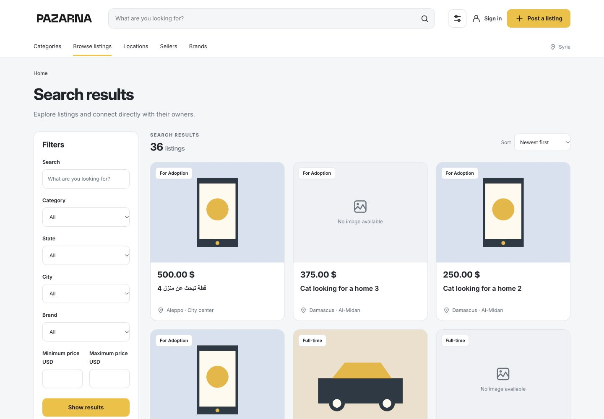
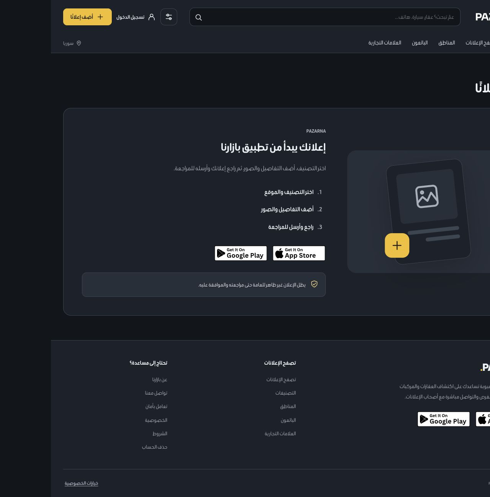

# Pazarna — Project Showcase

[English](README.md) · [Türkçe](README.tr.md) · [العربية](README.ar.md)

**IDEABAT PROJECT · LIVE · Web / Android / iOS · العربية / English**

A responsive website and Flutter mobile app for discovering classifieds, contacting sellers and submitting listings for review, with Arabic and English experiences.

Local UI captures use synthetic data. Flutter screens were rendered in a browser and must not be captioned as native Android/iOS screenshots. Live web captures are labeled separately.

## Challenge

A classifieds product needs to make many different categories understandable while keeping discovery, money, location and publication behavior consistent across a website and a mobile app. The inspected implementation addresses that product problem; no client interviews, research statistics or historical business baseline were supplied.

## Solution

Pazarna pairs responsive server-rendered pages with a Flutter application and shared backend rules. Category-aware fields, clear price or salary information, directional layouts and a saved mobile draft help users move from browsing to a considered submission.

1. Browse a category or search for an item or opportunity.
2. Narrow results, open a listing and inspect its images, location and relevant details.
3. Contact the listing owner directly; signed-in app users can save or report a listing.
4. Use the app to choose a category, enter information, review the listing and submit it for moderation.

## Mobile app: discover, save, prepare and review

   

Onboarding and language selection · Marketplace discovery · Search results

   

Saved listings · Category-aware filters · Listing details and gallery

   

Publication: choose a category · Publication: original amount and currency · Publication: optional photos

   

Publication: review before submission · Publication: received for review in local testing · Language, appearance and currency settings

## Responsive frontend: browse and inspect

Search results

Listing details and gallery

Website handoff to the mobile app

[Explore all 100 screenshots](GALLERY.md).

## Ideabat contribution

Presented as an IDEABAT PROJECT by the owner. The documented engineering scope comprises the responsive frontend, Flutter experience and shared PHP backend. This attribution does not assert exclusive ownership of every component or transfer any third-party rights.

- Responsive PHP website
- Flutter Android/iOS application
- Shared PHP APIs and MySQL-compatible data model
- Compact member page and web-to-app publication handoff

A PHP website and its API share business rules and a MySQL-compatible data model, while Flutter consumes a central network boundary. Sharing discovery logic helps align what appears in cards, search totals, listing details and saved-item results. Listing identity is separated from translated text, and taxonomy/location structures support category-aware browsing. The architecture is deliberately described at component level: no unverified cloud topology, multi-tenant isolation or large-scale benchmark is implied.

The mobile flow saves an owner-specific draft and preserves entered amounts and their original currency. The server checks category, geography, relevant fields and image constraints before receiving a listing. A stable submission identity and status reconciliation handle uncertain responses without blindly creating another listing. The local zero-photo journey reached a confirmed pending result, with the listing excluded from public discovery. Optional-photo UI does not establish physical-device photo permissions. Review and approval are a separate operational responsibility.

## Languages and experience

Arabic uses right-to-left layout and English uses left-to-right layout. The visual system combines charcoal surfaces, yellow actions and locally bundled Arabic/Latin typography. Light, dark and system preferences are independent of interface language and display currency. Translation resources include Turkish, but the active language selector allows Arabic and English. Representative phone/tablet/desktop captures and selected enlarged-text widget tests support specific layout observations; they do not establish full accessibility compliance.

## Project facts

- Project contact: RAGIP MULLAMUSA
- September 2025–April 2026, supplied by the project owner; November 2026 maintenance evidence is documented separately.
- PHP · MySQL-compatible SQL · Flutter / Dart · Provider

Delivered capabilities include connected web/mobile discovery, account and saved-listing flows, and a locally verified submission received in a pending state. No revenue, adoption, conversion, speed or uptime improvement is claimed.

Native device interactions and correspondence between the inspected source and current store binaries remain unverified. Arabic and English are active product languages; Turkish is the language of this portfolio translation, not an enabled product interface. A dedicated moderation console was not established.

## Official links and next steps

[Pazarna](https://pazarna.com/) · [Google Play](https://play.google.com/store/apps/details?id=pazarna.ideabat.com) · [App Store](https://apps.apple.com/us/app/%D8%A8%D8%A7%D8%B2%D8%A7%D8%B1%D9%86%D8%A7/id6759612932)

Live verified on 16 November 2026; this local package has not updated these pages.

**Portfolio:** [English](https://ideabat.com/portfolio/pazarna-classifieds-marketplace/) · [Türkçe](https://ideabat.com/tr/portfolio/pazarna-classifieds-marketplace/) · [العربية](https://ideabat.com/ar/portfolio/pazarna-classifieds-marketplace/)

**Case study:** [English](https://ideabat.com/case-study/pazarna-web-mobile-classifieds-marketplace/) · [Türkçe](https://ideabat.com/tr/case-study/pazarna-web-mobile-classifieds-marketplace/) · [العربية](https://ideabat.com/ar/case-study/pazarna-web-mobile-classifieds-marketplace/)

## Ownership and technical review

This repository contains documentation and approved visual material, not an application source release. Presentation through Ideabat does not transfer a client's ownership. For employment, collaboration or technical-review inquiries, contact Ragıp Mullamusa through Ideabat. Access to private project source requires prior permission from the project owner and compliance with applicable confidentiality requirements. Requests are reviewed individually; source access is not guaranteed. No software license or redistribution permission is granted by this showcase.

Ragıp Mullamusa is the founder of [Ideabat](https://ideabat.com/). For relevant engineering, employment or collaboration inquiries, use [the contact page](https://ideabat.com/contact-us/) or [info@ideabat.com](mailto:info@ideabat.com).
