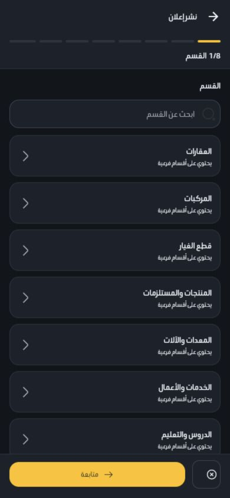

# Pazarna — Proje Sunumu

[English](README.md) · [Türkçe](README.tr.md) · [العربية](README.ar.md)

**IDEABAT PROJECT · LIVE · Web / Android / iOS · العربية / English**

İlan keşfi, satıcıyla doğrudan iletişim ve incelemeye ilan gönderimi için geliştirilen, Arapça ve İngilizce deneyimler sunan duyarlı web sitesi ve Flutter mobil uygulaması.

Yerel arayüz görüntüleri örnek veriler içerir. Flutter ekranları tarayıcıda alınmıştır; yerel Android/iOS görüntüsü olarak etiketlenmemelidir. Canlı web görüntüleri ayrıca belirtilmiştir.

## İhtiyaç

Çok kategorili bir ilan ürününde farklı içerikleri anlaşılır kılarken web ve mobilde arama, fiyat, konum ve gönderim davranışlarını tutarlı tutmak gerekir. İncelenen uygulama bu ihtiyacı ele alır; müşteri görüşmeleri, araştırma verileri veya geçmiş iş sonuçlarına ilişkin bir başlangıç ölçümü sunulmamıştır.

## Çözüm

Pazarna, sunucuda oluşturulan duyarlı sayfaları Flutter uygulaması ve ortak sunucu kurallarıyla birleştirir. Kategoriye uygun alanlar, anlaşılır fiyat veya ücret bilgileri, yazı yönüne uyumlu yerleşim ve kaydedilen mobil taslak, ilan hazırlama sürecini destekler.

1. Kategoriye göz at veya bir ürün ya da fırsat ara.
2. Sonuçları daralt; ilanı açıp görselleri, konumu ve ilgili ayrıntıları incele.
3. İlan sahibiyle doğrudan iletişime geç; uygulamada giriş yaparak ilan kaydet veya bildir.
4. Uygulamada kategori seç, bilgileri tamamla, ilanı gözden geçir ve incelemeye gönder.

## Mobil uygulama: keşfet, kaydet, hazırla ve kontrol et

   

Karşılama ve dil seçimi · İlan keşfi · Arama sonuçları

   

Kaydedilen ilanlar · Kategoriye uygun filtreler · İlan ayrıntıları ve galeri

   

İlan gönderimi: kategori seçimi · İlan gönderimi: tutar ve para birimi · İlan gönderimi: isteğe bağlı fotoğraflar

   

İlan gönderimi: son kontrol · İlan gönderimi: yerel testte inceleme bekleyen kayıt · Dil, görünüm ve para birimi ayarları

## Duyarlı ön yüz: gez ve incele

Arama sonuçları

İlan ayrıntıları ve galeri

Web sitesinden mobil uygulamaya yönlendirme

[100 ekran görüntüsünün tamamını incele](GALLERY.tr.md).

## Ideabat katkısı

Proje sahibi tarafından IDEABAT PROJECT olarak tanımlanmıştır. Belgelenen mühendislik kapsamı; duyarlı ön yüz, Flutter deneyimi ve ortak PHP sunucu uygulamasıdır. Bu atıf, her bileşenin münhasır mülkiyetini veya üçüncü kişilere ait hakların devrini ifade etmez.

- Duyarlı PHP web sitesi
- Flutter Android/iOS uygulaması
- Ortak PHP API ve MySQL uyumlu veri modeli
- Küçük üye sayfası ve webden uygulamaya ilan yönlendirmesi

PHP web sitesi ve API, ortak iş kurallarını ve MySQL uyumlu veri modelini kullanır; Flutter tek bir ağ katmanından iletişim kurar. Keşif kurallarının paylaşılması, kartlarda, sonuç sayılarında, ayrıntıda ve kaydedilen ilanlarda tutarlı görünürlüğü destekler. İlan kimliği çevrilmiş metinden ayrılır; kategori ve konum yapıları uygun filtrelemeyi mümkün kılar. Mimari bileşen düzeyinde anlatılmıştır. Doğrulanmamış bulut yapısı, çok kiracılı yalıtım veya büyük ölçek performans iddiası eklenmemiştir.

Mobil akış, kullanıcıya ait taslağı kaydeder; tutarı ve özgün para birimini korur. Sunucu ilanı almadan önce kategori, konum, ilgili alanlar ve görsel kısıtlarını denetler. Sabit bir gönderim kimliği ve durum sorgulama, belirsiz yanıt sonrasında körlemesine ikinci ilan oluşturmadan sonucu bulmaya yardımcı olur. Yerel ortamda fotoğrafsız akış, doğrulanmış inceleme bekliyor durumuna ulaşmış ve ilan genel sonuçlardan dışlanmıştır. İsteğe bağlı fotoğraf alanı, fiziksel cihaz izinlerinin doğrulandığı anlamına gelmez. İnceleme ve onay ayrı bir operasyonel sorumluluktur.

## Diller ve deneyim

Arapça arayüz sağdan sola, İngilizce arayüz soldan sağa düzenlenir. Koyu gri yüzeyler, sarı eylemler ve yerel olarak paketlenen Arapça/Latin yazı tipleri ortak kimliği oluşturur. Açık, koyu ve sistem temaları; arayüz dili ve görüntülenen para biriminden bağımsızdır. Türkçe çeviri dosyaları bulunsa da etkin dil seçimi Arapça ve İngilizcedir. Telefon, tablet ve masaüstü görselleriyle seçili büyük yazı testleri belirli yerleşimleri destekler; tam erişilebilirlik uyumluluğu belgelemez.

## Proje bilgileri

- Proje iletişim kişisi: RAGIP MULLAMUSA
- Proje sahibinin bildirdiği dönem: Eylül 2025–Nisan 2026. Kasım 2026 bakım kayıtları ayrı değerlendirilmiştir.
- PHP · MySQL-compatible SQL · Flutter / Dart · Provider

Ortaya çıkan yetenekler; web ve mobilde bağlantılı ilan keşfi, hesap ve kaydedilen ilan akışları ile yerel ortamda doğrulanmış, inceleme bekleyen ilan gönderimidir. Gelir, kullanım, dönüşüm, hız veya çalışma süresi artışı iddia edilmez.

Yerel cihaz etkileşimleri ve incelenen kaynak ile güncel mağaza sürümleri arasındaki eşleşme doğrulanmamıştır. Üründe Arapça ve İngilizce etkindir; bu portföyün Türkçe olması uygulamada Türkçenin açık olduğu anlamına gelmez. Ayrı bir moderasyon paneli doğrulanmamıştır.

## Resmî bağlantılar ve sonraki adımlar

[Pazarna](https://pazarna.com/) · [Google Play](https://play.google.com/store/apps/details?id=pazarna.ideabat.com) · [App Store](https://apps.apple.com/us/app/%D8%A8%D8%A7%D8%B2%D8%A7%D8%B1%D9%86%D8%A7/id6759612932)

16 Kasım 2026 tarihinde yayında olduğu doğrulandı; bu yerel paket sayfalara yüklenmedi.

**Portföy:** [English](https://ideabat.com/portfolio/pazarna-classifieds-marketplace/) · [Türkçe](https://ideabat.com/tr/portfolio/pazarna-classifieds-marketplace/) · [العربية](https://ideabat.com/ar/portfolio/pazarna-classifieds-marketplace/)

**Vaka incelemesi:** [English](https://ideabat.com/case-study/pazarna-web-mobile-classifieds-marketplace/) · [Türkçe](https://ideabat.com/tr/case-study/pazarna-web-mobile-classifieds-marketplace/) · [العربية](https://ideabat.com/ar/case-study/pazarna-web-mobile-classifieds-marketplace/)

## Mülkiyet ve teknik inceleme

Bu depo, uygulamanın kaynak kodunu değil, dokümantasyonu ve onaylı görsel materyalleri içerir. Projenin Ideabat üzerinden sunulması, bir müşterinin mülkiyet haklarını devretmez. İş, iş birliği veya teknik inceleme talepleri için Ideabat aracılığıyla Ragıp Mullamusa ile iletişime geçebilirsiniz. Özel proje kaynağına erişim, proje sahibinin önceden iznine ve geçerli gizlilik yükümlülüklerine uyulmasına bağlıdır. Talepler ayrı ayrı değerlendirilir; kaynak erişimi garanti edilmez. Bu sunum herhangi bir yazılım lisansı veya yeniden dağıtım izni vermez.

Ragıp Mullamusa, [Ideabat](https://ideabat.com/) kurucusudur. Mühendislik, iş veya iş birliği konularında [iletişim sayfasını](https://ideabat.com/contact-us/) ya da [info@ideabat.com](mailto:info@ideabat.com) adresini kullanabilirsiniz.
